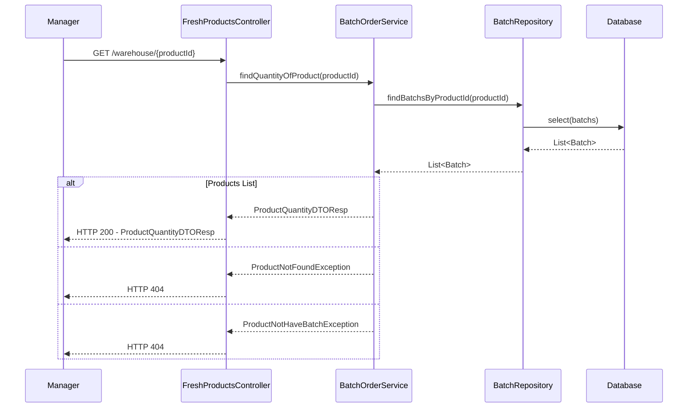
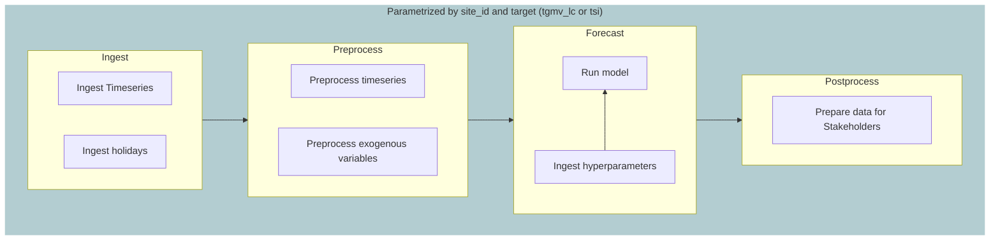
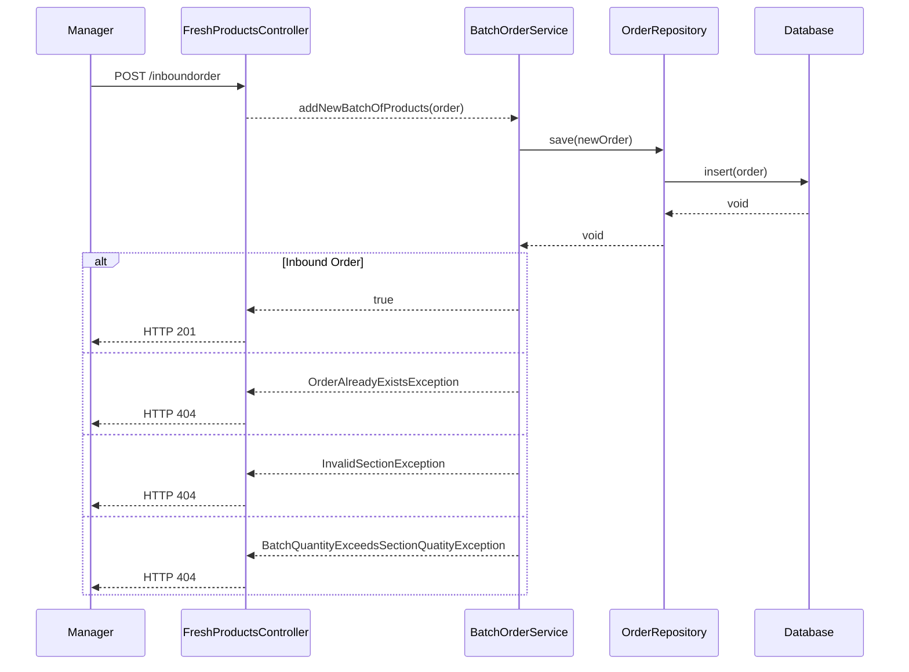
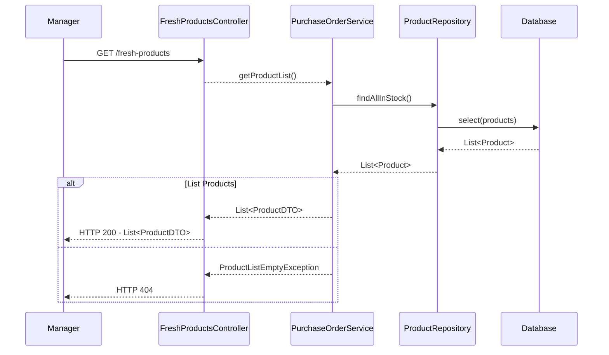
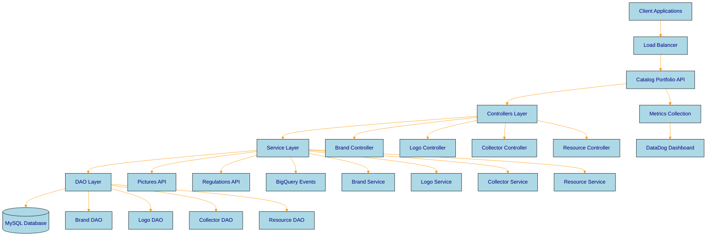
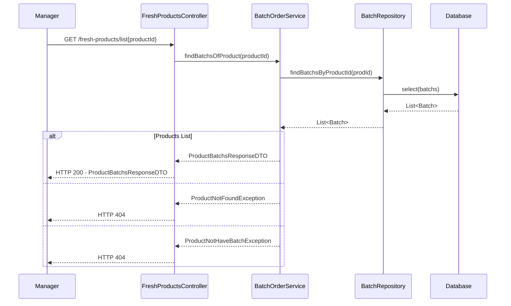

# Revisión humana del LLM-juez (QA)

Para cada pregunta, completá su fila en `qa_judge_labels.csv` (por `qa_id`):

- `accept`: `si` si la pregunta debería quedar en el dataset, `no` si no.
- `faithfulness` (1-5, solo `llm`): ¿la respuesta está totalmente respaldada por la ficha?
- `clarity` (1-5): ¿la pregunta se entiende sin ver la ficha y tiene una sola respuesta?
- `usefulness` (1-5): ¿alguien que trabaja con el proyecto la haría? ¿no es trivial?
- `nota`: libre.

En `unanswerable` la respuesta esperada es que la documentación no lo especifica: aceptala
solo si la ficha (y, hasta donde sepas, el resto de la documentación del proyecto) no la
responde. El orden es aleatorio y no se muestran los puntajes del juez.

Preguntas: 30.

---

### 1 · qa-b5115bf9787b533c · llm

- **Ficha:** catalog-portfolio-api › guide/troubleshooting/README.md › Troubleshooting › Monitoring and Alerts › Key Metrics to Monitor (`ck-38292c842f70a445`)
- **Pregunta:** What is the recommended maximum heap usage for the catalog-portfolio-api?
- **Respuesta:** Heap usage should be less than 85%
- **Evidencia:** `4. **Memory Usage**: Heap usage < 85%`

```markdown
### Key Metrics to Monitor

1. **Response Times**: Average < 100ms
2. **Error Rates**: < 1% for 4xx/5xx errors
3. **Database Connections**: Pool utilization < 80%
4. **Memory Usage**: Heap usage < 85%
```

---

### 2 · qa-8a9fea24852d92a2 · llm

- **Ficha:** catalog-portfolio-api › guide/troubleshooting/README.md › Troubleshooting › Quick Diagnostic › Health Check · Database Connection · Configuration Check (`ck-06ba69c75cdd0efd`)
- **Pregunta:** How can you verify the service is running using a ping command?
- **Respuesta:** Use the curl command to check the service health by sending a ping request to http://localhost:8080/catalog/brands/ping. The expected response is 'pong'.
- **Evidencia:** `# Check service health
curl http://localhost:8080/catalog/brands/ping
# Expected: "pong"`

````markdown
### Health Check

First, verify the service is running:

```bash
# Check service health
curl http://localhost:8080/catalog/brands/ping
# Expected: "pong"

# Check if port is in use
lsof -i :8080
```

### Database Connection

Verify database connectivity:

```bash
# Test MySQL connection
mysql -h localhost -u your_username -p -e "SELECT 1;"

# Check database exists
mysql -h localhost -u your_username -p -e "SHOW DATABASES LIKE 'brands_%';"
```

### Configuration Check

Verify configuration files:

```bash
# Check if configuration files exist
ls -la src/main/resources/development/
ls -la src/main/resources/production/

# Validate properties format
grep -v '^#' src/main/resources/development/application.properties
```
````

---

### 3 · qa-57e6fb5245b79f57 · llm

- **Ficha:** payment-promise-gateway › guide/README.md › Payment Promise Gateway › API Documentation · Sequence Diagrams (`ck-7215d0a1915b463d`)
- **Pregunta:** What is the HTTP method for the endpoint that retrieves active payment promises?
- **Respuesta:** The endpoint for retrieving active payment promises uses the GET method.
- **Evidencia:** `2. `GET /payment_promise/active``

```markdown
## API Documentation

The API is documented using OpenAPI/Swagger. Main endpoints:

1. `GET /payment_promise/form`
2. `GET /payment_promise/active`
3. `GET /offers`
4. `POST /payment_promise`
5. `POST /forgiveness_proposal`
6. `PUT /forgiveness_proposal`
7. `GET /forgiveness_proposal/{promiseId}`

Detailed API documentation can be found in [specs-hub](https://web.workflowcloud.io/payment-promise-gateway/specs-hub).

## Sequence Diagrams

This section provides sequence diagrams for each API endpoint, showing the interaction flow between system components.
```

---

### 4 · qa-26acaf543d279104 · llm

- **Ficha:** traffic-gate-api › guide/sections/database.md › Base de datos (`ck-c4dfb2dc0a5c0709`)
- **Pregunta:** ¿Qué tabla guarda el estado de los jobs que llaman a /whitelist en Traffic Gate API?
- **Respuesta:** La tabla Execution guarda el estado de los jobs que llaman a /whitelist.
- **Evidencia:** `- **Tabla Execution**: En esta tabla se guarda el estado de los jobs que hacen los llamados a los endpoints de la API de traffic-gate.`

```markdown
# Base de datos

La base de datos de Traffic Gate consta de 5 tablas:

- **Tabla Execution**: En esta tabla se guarda el estado de los jobs que hacen los llamados a los endpoints de la API de traffic-gate. Se guarda el nombre del job, fecha y el estado de la ejecución. *En el momento solo se está guardando el estado de los jobs que llaman a /whitelist. Las ejecuciones desde el job de /whitelist/purge no se están guardando*

- **Tabla Blacklist**: En esta tabla se guardan las direcciones ip que se encuentran bloqueadas por alguna regla de una Web ACL del WAF. Cuando traffic-gate determina que alguna de estas ips no deben ser bloqueadas, entonces notifica a trunks para enviar la ip a la whitelist y actualiza la columna 'whitelisted' a true

- **Tabla Whitelist**: En esta tabla se guardan las direcciones ip que se envían a una whitelist en las reglas del WAF. Después de cierto tiempo, se determina mediante un proceso de purga, si la ip debe continuar autorizada en la whitelist o si ya se puede remover de la misma. Cuando se determina que una ip ya no debe pertenecer a una whitelist, se hace un borrado lógico en base de datos, actualizando el campo 'deleted' en true.

- **Tabla Rules**: En esta tabla se guardan las reglas que están configuradas en el WAF y que están asociadas a alguna Web_ACL para bloqueo por límite máximo de tráfico. En toda la aplicación de Traffic Gate, solo se consultan estas reglas en el endpoint de /whitelist (func WhitelistJob). Lo que se hace es consultar las reglas asociadas a algún scope (front, api, pci, global_pci) y retornar la información de tales reglas con la WEB_ACL asociada. *No existe ningún controlador, ni servicio ni dao asociado a esta tabla, lo cual implica que cualquier cambio en las reglas se configura manualmente.*

- **Tabla IP**: En esta tabla se guarda toda la información relacionada a una dirección IP, que se emplea para determinar si tal dirección debe seguir siendo bloqueada por límite de tráfico o si se debe desbloquear y agregar a una whitelist.
```

---

### 5 · qa-ed9512d427dd0bfc · llm

- **Ficha:** catalog-portfolio-api › guide/troubleshooting/README.md › Troubleshooting › Common Error Categories › 🗄️ Database Issues (`ck-ada54bcceca2bdca`)
- **Pregunta:** What should be done when the connection pool is exhausted?
- **Respuesta:** Increase pool size or fix connection leaks.
- **Evidencia:** `| Increase pool size or fix connection leaks |`

```markdown
### 🗄️ Database Issues

| Issue | Symptoms | Solution |
| --- | --- | --- |
| **Connection Pool Exhausted** | Timeout errors | Increase pool size or fix connection leaks |
| **Slow Queries** | High response times | Add database indexes, optimize queries |
| **Lock Timeouts** | Deadlock errors | Review transaction boundaries |
| **Migration Failures** | Schema inconsistencies | Rollback and rerun migrations |
```

---

### 6 · qa-30a1b3ce99e36f08 · llm

- **Ficha:** demand-forecast-docs › guide/explicabilidad/diarizacion.md › Diarización › Implementation (`ck-9d571658d13d71ec`)
- **Pregunta:** Where can the implementation of diarización be found?
- **Respuesta:** The implementation can be found in the file located at https://github.com/retailcorpsrc/retail_demand-forecast/blob/6a6612004f7a329935f791777bf9b428cd307eac/src/marketplace/sktime/transformations/temporal_forecast_proportions.py#L4.
- **Evidencia:** `The implementation can be found [in this file](https://github.com/retailcorpsrc/retail_demand-forecast/blob/6a6612004f7a329935f791777bf9b428cd307eac/src/marketplace/sktime/transformations/temporal_forecast_proportions.py#L4).`

```markdown
## Implementation

The implementation can be found [in this file](https://github.com/retailcorpsrc/retail_demand-forecast/blob/6a6612004f7a329935f791777bf9b428cd307eac/src/marketplace/sktime/transformations/temporal_forecast_proportions.py#L4).
```

---

### 7 · qa-77ac44739d0e0e6c · unanswerable

- **Ficha:** catalog-portfolio-api › guide/brand-management/README.md › Brand Management › Overview (`ck-c990befa14371174`)
- **Pregunta:** What are the specific validation rules applied to brand names during the creation process?
- **Respuesta:** The documentation does not specify this.

```markdown
## Overview

Brand management is the core functionality of the Catalog Portfolio API service. This section covers all aspects of brand operations from creation to activation, including validation rules and business logic.

**Available Items:**

- [Brand Lifecycle](lifecycle.md) - Complete brand state management and transitions
- [Creating Brands](creation.md) - Step-by-step brand creation process
- [Brand Updates](updates.md) - Updating existing brand information
- [Brand Activation](activation.md) - Brand activation process and requirements
- [Brand Validation](validation.md) - Validation rules and business logic
```

---

### 8 · qa-ebd8f5a0d11fd231 · llm

- **Ficha:** traffic-gate-api › guide/README.md › Traffic Gate › Criterios de Whitelist por Scope (part 2/4) (`ck-3f5ceed427342891`)
- **Pregunta:** ¿Cuáles son los criterios para enviar una dirección IP a whitelist si está bloqueada por un ratelimit en el scope front?
- **Respuesta:** La dirección IP se debe enviar a whitelist si tuvo más de un usuario detrás en la última hora, tiene asociado un BigSeller, un CBT, pertenece a infraestructura RetailHub o pertenece a un bot bueno.
- **Evidencia:** `- La dirección IP tuvo más de un usuario detrás en la última hora
- La dirección IP tiene asociado un BigSeller
- La dirección IP tiene asociado un CBT.
- La dirección IP pertenece a infraestructura RetailHub.
- La dirección IP pertenece a un bot bueno.`

```markdown
Traffic Gate se encarga de evaluar cada cierto tiempo, si las direcciones IP afectadas por ratelimit cumplen algún criterio que determine que alguna de ellas se deba enviar a whitelist o no. Para ello, traffic gate enriquece la metadata de la IP, con información consultada desde las Knowledge APIs del ecosistema de Anomaly (isBot, isRetailHub, isCloud, users-analysis, users-behind, mobile-applications-behind).

<details><summary><strong> SCOPE FRONT</strong></summary>

Una dirección IP bloqueada por un ratelimit aplicado al scope front, se debe enviar a whitelist si cumple alguno de los siguientes criterios:

- La dirección IP tuvo más de un usuario detrás en la última hora
- La dirección IP tiene asociado un BigSeller
- La dirección IP tiene asociado un CBT.
- La dirección IP pertenece a infraestructura RetailHub.
- La dirección IP pertenece a un bot bueno.

</details>
```

---

### 9 · qa-13354deb7e8bdbbe · llm

- **Ficha:** zenith-keeper › guide/use-cases.md › Use cases (part 10/12) (`ck-24f5746ed048a1ec`)
- **Pregunta:** What HTTP response does the FreshProductsController send if the product is found but has no batches?
- **Respuesta:** The controller sends HTTP 404.
- **Evidencia:** `S-->>C: ProductNotHaveBatchException
C-->>M: HTTP 404`

````markdown
GET /warehouse{productId}

````

---

### 10 · qa-3c52feb228ecde8e · llm

- **Ficha:** catalog-portfolio-api › guide/architecture/README.md › Architecture Overview › Key Architectural Principles › 1. Layered Architecture · 2. Separation of Concerns · 3. Scalability · 4. Reliability (`ck-cd44b77da9741a85`)
- **Pregunta:** What layer handles HTTP requests and responses in the catalog-portfolio-api architecture?
- **Respuesta:** Controllers handle HTTP requests and responses.
- **Evidencia:** `- **Controllers**: Handle HTTP requests and responses`

```markdown
### 1. Layered Architecture

- **Controllers**: Handle HTTP requests and responses
- **Services**: Implement business logic and validations
- **DAOs**: Manage data access and persistence
- **Models**: Define data structures and entities

### 2. Separation of Concerns

- Clear boundaries between layers
- Single responsibility principle
- Loose coupling between components

### 3. Scalability

- Stateless service design
- Horizontal scaling capabilities
- Connection pooling for database access

### 4. Reliability

- Comprehensive error handling
- Circuit breaker patterns for external services
- Health checks and monitoring
```

---

### 11 · qa-073a47900296e455 · unanswerable

- **Ficha:** traffic-gate-api › guide/sections/processes.md › Procesos de Whitelist y Purga › Encolamiento de IPs Bloqueadas por Ratelimit (part 2/3) (`ck-27fd01bda376fb06`)
- **Pregunta:** ¿Cuál es el tiempo máximo de espera para que se realice la actualización en la tabla execution?
- **Respuesta:** La documentación no lo especifica.

````markdown
```json
{
    "ip": "x.x.x.x/32",
    "rule": {
        "ID": 25,
        "Name": "RATE_SUSPECT_COUNTRIES_REST",
        "WafID": "SUSPECT_COUNTRIES_REST",
        "WebAcl": "WAF_WACL_FRONT_REST"
    },
    "scope": "front"
}
```

4. Se guarda el estado de la ejecución de esta tarea, incluyendo un valor lógico si la operación fue exitosa o no y el scope recibido. Esta actualización se realiza sobre la tabla execution.
````

---

### 12 · qa-882adf0f78fa6c3d · unanswerable

- **Ficha:** catalog-portfolio-api › guide/api-reference/brands.md › Brand Endpoints › Error Responses › Common Error Codes · Error Response Format (`ck-e4e6bbe2c9de4c89`)
- **Pregunta:** What are the possible values for the 'cause' field in the error response format?
- **Respuesta:** The documentation does not specify this.

````markdown
### Common Error Codes

| Code | Error | Description |
| --- | --- | --- |
| 400 | `validation_error` | Request validation failed |
| 401 | `unauthorized` | Missing or invalid authentication |
| 403 | `forbidden` | Insufficient permissions |
| 404 | `brand_not_found` | Brand ID does not exist |
| 409 | `brand_name_already_exists` | Brand name already exists in site |
| 422 | `logos_missing` | Required logos not uploaded |
| 500 | `internal_server_error` | Internal server error |

### Error Response Format

```json
{
  "error": "brand_not_found",
  "message": "Brand with ID 123 was not found",
  "status": 404,
  "cause": []
}
```
````

---

### 13 · qa-5fd997a2800d1f9c · unanswerable

- **Ficha:** traffic-gate-api › guide/README.md › Traffic Gate (`ck-974b53792ef9efb0`)
- **Pregunta:** ¿Cuál es el intervalo de tiempo con el que Traffic Gate consulta las direcciones IP bloqueadas?
- **Respuesta:** La documentación no lo especifica.

```markdown
# Traffic Gate

Traffic Gate es la aplicación que se encarga de agregar a una lista blanca o whitelist, aquellas direcciones IP que no deben ser alcanzadas por reglas de ratelimit aplicadas en el WAF. Para lograrlo, esta aplicación consulta cada cierto tiempo las direcciones IPs que han sido bloqueadas por alguna regla de ratelimit, recopila toda la información posible relacionada a cada una de estas direcciones, y evalúa de acuerdo a ciertas reglas de negocio si debe levantarse el bloqueo a tal ip (agregar a whitelist) o no. Adicionalmente, esta aplicación habilita a los usuarios por medio de una API, para consultar direcciones IP bloqueadas, obtener históricos o para agregar manualmente una dirección IP a una whitelist.
```

---

### 14 · qa-1e5dce72634b9a94 · llm

- **Ficha:** demand-forecast-docs › guide/overview.md › Getting to know our tooling › The data pipelines (`ck-abd0b025127b255d`)
- **Pregunta:** Where can the forecast classes be found in the project structure?
- **Respuesta:** The forecast classes can be found at `src/app/pipes/forecasting`.
- **Evidencia:** `The forecast classes can be found at `src/app/pipes/forecasting`.`

````markdown
## The data pipelines

Now, let's understand the macro picture of the data pipeline. The data pipeline is divided into modules that are independent of each other, and each is responsible to a particular aspect of the data pipeline. We represent the data pipeline as a flowchat below:



The `Ingest` module is responsible for ingesting the timeseries and holidays data. The `Preprocess` module is responsible for preprocessing the timeseries and exogenous variables, by filling in missing dates and putting it into a dataframe in the right format for forecasting. The `Forecast` module is responsible for running the model and ingesting the hyperparameters. The `Postprocess` module is responsible for preparing the data for stakeholders, by creating the tables in the format we have agreed with them.

Each module is in a directory of our project. The ingest classes can be found at `src/app/pipes/ingest`. The preprocess classes can be found at `src/app/pipes/preprocessing`. The forecast classes can be found at `src/app/pipes/forecasting`. The postprocess classes can be found at `src/app/pipes/postprocessing`.
````

---

### 15 · qa-b721309c01574992 · unanswerable

- **Ficha:** catalog-portfolio-api › guide/README.md › Catalog Portfolio API Documentation › 📚 Documentation Sections (`ck-91af07dc16454e6e`)
- **Pregunta:** What are the default values for the environment variables required during the setup and installation of the Catalog Portfolio API?
- **Respuesta:** The documentation does not specify this.

```markdown
## 📚 Documentation Sections

<div class="content-grid">
  <div class="content-card">
    <div class="card-icon">⚙️</div>
    <h3>Setup & Installation</h3>
    <p>Get started with local development setup, dependencies, and environment configuration for the Catalog Portfolio API service.</p>
  </div>

  <div class="content-card">
    <div class="card-icon">🏗️</div>
    <h3>Architecture Overview</h3>
    <p>Comprehensive system architecture, component interactions, database design, and integration patterns.</p>
  </div>

  <div class="content-card">
    <div class="card-icon">📡</div>
    <h3>API Reference</h3>
    <p>Complete REST API documentation with endpoints, request/response schemas, authentication, and code examples.</p>
  </div>

  <div class="content-card">
    <div class="card-icon">🏷️</div>
    <h3>Brand Management</h3>
    <p>Brand lifecycle management, creation, updates, activation processes, and validation rules.</p>
  </div>

  <div class="content-card">
    <div class="card-icon">🔧</div>
    <h3>Troubleshooting</h3>
    <p>Common issues, error codes, debugging guides, and solutions for frequent problems.</p>
  </div>
</div>
```

---

### 16 · qa-6dd906e227f7f5c2 · llm

- **Ficha:** zenith-keeper › guide/use-cases.md › Use cases (part 1/12) (`ck-136611699b35c70e`)
- **Pregunta:** What HTTP status code is returned when an inbound order is successfully added?
- **Respuesta:** HTTP 201
- **Evidencia:** `C-->>M: HTTP 201`

````markdown
# Use cases

Fresh products API documentation - sequence diagrams

POST /fresh-products/inboundorder

````

---

### 17 · qa-5287dd5f2a989df1 · llm

- **Ficha:** zenith-keeper › guide/use-cases.md › Use cases (part 3/12) (`ck-9563ac9e9dbdfc6c`)
- **Pregunta:** What HTTP status code is returned when there are no products in stock?
- **Respuesta:** HTTP 404
- **Evidencia:** `C-->>M: HTTP 404`

````markdown
GET /fresh-products

````

---

### 18 · qa-f8eec443548bb9ad · unanswerable

- **Ficha:** catalog-portfolio-api › guide/troubleshooting/README.md › Troubleshooting › Getting Help › Log Analysis · Support Channels · Escalation Process (`ck-bbcd73da9249ddb5`)
- **Pregunta:** What are the steps to perform a manual backup of the database, and is it recommended for certain environments?
- **Respuesta:** The documentation does not specify this.

```markdown
### Log Analysis

When reporting issues, include:

1. **Error messages** from application logs
2. **Request/response** examples
3. **Environment details** (Java version, MySQL version)
4. **Configuration** (sanitized, no passwords)

### Support Channels

- **Email**: [instore_devs@retailflow.com](mailto:instore_devs@retailflow.com)
- **Slack**: #instore-dev
- **Monitoring**: [DataDog Dashboard](https://monitoring.retailflow.io/dashboard/vua-inb-9et?fromUser=false&refresh_mode=sliding&from_ts=1750955519638&to_ts=1750959119638&live=true)

### Escalation Process

1. **Level 1**: Check this troubleshooting guide
2. **Level 2**: Search existing documentation and logs
3. **Level 3**: Contact development team with detailed information
4. **Level 4**: Emergency escalation for production issues
```

---

### 19 · qa-2fe75aa45951d7c2 · unanswerable

- **Ficha:** catalog-portfolio-api › guide/architecture/README.md › Architecture Overview › Architecture Diagram (`ck-5154c0938a5ba8e8`)
- **Pregunta:** What is the database schema used for the MySQL Database mentioned in the architecture diagram?
- **Respuesta:** The documentation does not specify this.

````markdown
## Architecture Diagram

  <i class="fas fa-download"></i> Download Architecture Template


````

---

### 20 · qa-1c09f5c7dd98fe91 · llm

- **Ficha:** catalog-portfolio-api › guide/api-reference/README.md › API Reference › Response Format · Error Format · Rate Limiting · Testing (`ck-529851e8927c7975`)
- **Pregunta:** What is the rate limit for the API?
- **Respuesta:** The rate limit is 1000 requests per minute per client.
- **Evidencia:** `- **Rate Limit**: 1000 requests per minute per client`

````markdown
## Response Format

All API responses follow a consistent format:

```json
{
  "data": {
    // Response payload
  },
  "paging": {
    "total": 100,
    "offset": 0,
    "limit": 50
  },
  "status": 200
}
```

## Error Format

Error responses include detailed information:

```json
{
  "error": "brand_not_found",
  "message": "Brand with ID 123 was not found",
  "status": 404,
  "cause": []
}
```

## Rate Limiting

- **Rate Limit**: 1000 requests per minute per client
- **Headers**: `X-RateLimit-Limit`, `X-RateLimit-Remaining`

## Testing

Use the interactive [Swagger UI](https://web.flowcloudcloud.io/catalog-portfolio-api/specs-hub) for live API testing.
````

---

### 21 · qa-39a323ef2b8496b3 · llm

- **Ficha:** traffic-gate-api › guide/sections/waf_config.md › Configuración WAF AWS (part 3/5) (`ck-d94976c297a352a7`)
- **Pregunta:** ¿Cuál es el límite de ratelimit para USA en el WAF de RetailHub?
- **Respuesta:** El WAF tiene configurado un ratelimit de 1000 solicitudes cada 5 minutos para la región de USA.
- **Evidencia:** `* 🇺🇸 USA`

```markdown
<details><summary><strong> Ratelimit USA </strong></summary>

En Estados Unidos, RetailHub y sus aliados tiene alojada la mayoría de infraestructura a nivel tecnológico (Hosting, Nubes públicas y privadas), por lo que aunque es un país No-RetailHub, se le da un trato especial dentro del WAF, el cual tiene configurado un ratelimit de 1000 solicitudes cada 5 minutos para esta región. [(Ver en consola AWS)](https://us-east-1.console.aws.amazon.com/wafv2/homev2/web-acl/rule/WAF_WACL_FRONT_ARG/12c89d7d-2884-46e5-9fa0-ba50450dec22/RATE_USA_AR?region=global)

  * 🇺🇸 USA

</details>
```

---

### 22 · qa-c49f2df599299c94 · llm

- **Ficha:** catalog-portfolio-api › guide/api-reference/brands.md › Brand Endpoints › Error Responses › Common Error Codes · Error Response Format (`ck-e4e6bbe2c9de4c89`)
- **Pregunta:** What is the error code for a brand not found?
- **Respuesta:** The error code for a brand not found is 404.
- **Evidencia:** `| 404 | `brand_not_found` | Brand ID does not exist |`

````markdown
### Common Error Codes

| Code | Error | Description |
| --- | --- | --- |
| 400 | `validation_error` | Request validation failed |
| 401 | `unauthorized` | Missing or invalid authentication |
| 403 | `forbidden` | Insufficient permissions |
| 404 | `brand_not_found` | Brand ID does not exist |
| 409 | `brand_name_already_exists` | Brand name already exists in site |
| 422 | `logos_missing` | Required logos not uploaded |
| 500 | `internal_server_error` | Internal server error |

### Error Response Format

```json
{
  "error": "brand_not_found",
  "message": "Brand with ID 123 was not found",
  "status": 404,
  "cause": []
}
```
````

---

### 23 · qa-6cb5460237a9a768 · llm

- **Ficha:** order-workflow-api › guide/services/database.md › Database › Objects stored › Workflows (`ck-55b5c02067e28efc`)
- **Pregunta:** What are the two types of workflows currently used in the project?
- **Respuesta:** The two types of workflows currently used are Gitflow and Libflow.
- **Evidencia:** `- Gitflow
- Libflow`

````markdown
#### Workflows

A workflow represents a valid git flow in use for Release process.

Currently we have two types:

- Gitflow
- Libflow

A Workflow object is represented as a JSON as follows:

```
{
    "default_branch": "develop",
    "name": "gitflow",
    "documentation_link": "https://release-process.retailcorp-cloud.io/#/lang-es/workflows/02_gitflow?id=branches-destacados",
    "stable_branches": [
        {
            "name": "master",
            "name_pattern": "^master$",
            "code_review_enabled": false,
            "accept_forks": false,
            "valid_head_branch_patterns": [
                "^release/.*",
                "^hotfix/.*",
                "^revert-.*",
                "^migration/.*"
            ],
            "releasable": true,
            "candidate": false
        },
        {
            "name": "develop",
            "name_pattern": "^develop$",
            "code_review_enabled": true,
            "accept_forks": true,
            "valid_head_branch_patterns": [
                "^feature/.*",
                "^enhancement/.*",
                "^bugfix/.*",
                "^fix/.*",
                "^revert-.*",
                "^hotfix/.*",
                "^release/.*",
                "^backport/.*"
            ],
            "releasable": false,
            "candidate": false
        },
        {
            "name": "release",
            "name_pattern": "^release/.*",
            "code_review_enabled": true,
            "accept_forks": false,
            "valid_head_branch_patterns": [
                "^fix/.*",
                "^revert-.*",
                "^hotfix/.*",
                "^backport/.*"
            ],
            "releasable": false,
            "candidate": true
        }
    ],
    "relevant_branches": [
        "^master$",
        "^develop$",
        "^release/.*",
        "^hotfix/.*",
        "^feature/.*",
        "^fix/.*",
        "^bugfix/.*",
        "^enhancement/.*",
        "^revert-.*",
        "^migration/.*",
        "^backport/.*"
    ],
    "backport_rules": [
        {
            "base_trigger_pattern": "^master$",
            "head_trigger_pattern": "^hotfix/.*$",
            "backport_to": [
                {
                    "base_branch_pattern": "^develop$",
                    "only_active_pull_requests": false
                },
                {
                    "base_branch_pattern": "^release/.*",
                    "only_active_pull_requests": true
                }
            ]
        },
        {
            "base_trigger_pattern": "^master$",
            "head_trigger_pattern": "^release/.*$",
            "backport_to": [
                {
                    "base_branch_pattern": "^develop$",
                    "only_active_pull_requests": false
                },
                {
                    "base_branch_pattern": "^release/.*",
                    "only_active_pull_requests": true
                }
            ]
        },
        {
            "base_trigger_pattern": "^master$",
            "head_trigger_pattern": "^migration/.*$",
            "backport_to": [
                {
                    "base_branch_pattern": "^develop$",
                    "only_active_pull_requests": false
                },
                {
                    "base_branch_pattern": "^release/.*",
                    "only_active_pull_requests": true
                }
            ]
        }
    ],
    "releasable_branches": [
        "^master$"
    ],
    "cron_branches": {
        "version_branch": "release",
        "stable_branch": "develop",
        "target_branch": "master"
    }
}
```
````

---

### 24 · qa-5dbd6a2cb0c43684 · unanswerable

- **Ficha:** zenith-keeper › guide/use-cases.md › Use cases (part 8/12) (`ck-6c54d470a4025bbd`)
- **Pregunta:** What is the timeout for the database query in the `findBatchsByProductId` method?
- **Respuesta:** The documentation does not specify this.

````markdown
GET /fresh-products/list{productId}

````

---

### 25 · qa-3d2d48e44caafd8c · llm

- **Ficha:** catalog-portfolio-api › guide/api-reference/brands.md › Brand Endpoints › Create Brand › `POST /` (`ck-63148aff5de23d14`)
- **Pregunta:** What is the required format for the `name` field in the request body?
- **Respuesta:** The `name` field must be a unique brand name within the specified site.
- **Evidencia:** `- `name`: Brand name (must be unique within site)`

````markdown
### `POST /`

**Request Body:**

```json
{
  "name": "Example Brand",
  "soft_descriptor": "EXAMPLE",
  "site": "MLA",
  "category": 5611201,
  "subcategories": [123, 456],
  "type": "lighthouse",
  "tags": ["tag1", "tag2"],
  "priority": 5,
  "business_description": "Business description text"
}
```

**Required Fields:**
- `name`: Brand name (must be unique within site)
- `site`: RetailFlow site code
- `category`: Primary category ID
- `type`: Brand type (lighthouse or standard)

**Example Request:**

```bash
curl -X POST "https://api.mp.internal.retailflow.com/catalog/brands/" \
  -H "Content-Type: application/json" \
  -d '{
    "name": "Example Brand",
    "site": "MLA",
    "category": 5611201,
    "type": "lighthouse"
  }'
```

**Example Response:**

```json
{
  "id": 123,
  "name": "Example Brand",
  "site": "MLA",
  "category": 5611201,
  "type": "lighthouse",
  "status": "STAND_BY",
  "date_created": "2024-01-15T10:30:00.000-03:00",
  "date_last_updated": "2024-01-15T10:30:00.000-03:00"
}
```
````

---

### 26 · qa-b77965d278a5d08a · llm

- **Ficha:** catalog-portfolio-api › guide/setup/local-development.md › Local Development Setup › IDE Configuration › IntelliJ IDEA · VS Code (`ck-b8f4a0214b238978`)
- **Pregunta:** What is the recommended Java version for IntelliJ IDEA in the catalog-portfolio-api project?
- **Respuesta:** Java 17
- **Evidencia:** `2. Set Project SDK to Java 17`

```markdown
### IntelliJ IDEA

1. Import project as Gradle project
2. Set Project SDK to Java 17
3. Configure code style:
   - Import `config/checkstyle/checkstyle-main.xml`
   - Set line separator to LF
   - Set encoding to UTF-8

### VS Code

Install recommended extensions:
- Java Extension Pack
- Gradle for Java
- MySQL
```

---

### 27 · qa-26da8f754d562740 · unanswerable

- **Ficha:** traffic-gate-api › guide/README.md › Traffic Gate › Criterios de Whitelist por Scope (part 4/4) (`ck-12b550870d2ed002`)
- **Pregunta:** ¿Cuál es el procedimiento para solicitar la inclusión de una dirección IP en la whitelist según los criterios de PCI y PCI GLOBAL?
- **Respuesta:** La documentación no lo especifica.

```markdown
<details><summary><strong>SCOPE PCI</strong></summary>

Una dirección IP bloqueada por un ratelimit aplicado al scope pci, se debe enviar a whitelist si cumple alguno de los siguientes criterios:
- La dirección IP tuvo más de un usuario detrás en la última hora
- Si el usuario detrás de la dirección IP es un usuario considerado confiable por User Reputation
- La dirección IP tiene asociado un BigSeller
- La dirección IP tiene asociado un CBT.
- La dirección IP pertenece a infraestructura RetailHub.
- La dirección IP tiene una aplicación certificada o privada detrás
- La dirección IP pertenece a un bot bueno.
</details>

<details><summary><strong>SCOPE PCI GLOBAL</strong></summary>

Una dirección IP bloqueada por un ratelimit aplicado al scope pci-global, se debe enviar a whitelist si cumple alguno de los siguientes criterios:
- La dirección IP tuvo más de un usuario detrás en la última hora
- Si el usuario detrás de la dirección IP es un usuario considerado confiable por User Reputation
- La dirección IP tiene asociado un BigSeller
s- La dirección IP pertenece a infraestructura RetailHub.
- La dirección IP tiene una aplicación certificada o privada detrás
- La dirección IP pertenece a un bot bueno.
</details>
```

---

### 28 · qa-7325abe36a5f689d · unanswerable

- **Ficha:** catalog-portfolio-api › guide/troubleshooting/README.md › Troubleshooting › Quick Diagnostic › Health Check · Database Connection · Configuration Check (`ck-06ba69c75cdd0efd`)
- **Pregunta:** What should I do if the service is not running and the ping endpoint is not responding?
- **Respuesta:** The documentation does not specify this.

````markdown
### Health Check

First, verify the service is running:

```bash
# Check service health
curl http://localhost:8080/catalog/brands/ping
# Expected: "pong"

# Check if port is in use
lsof -i :8080
```

### Database Connection

Verify database connectivity:

```bash
# Test MySQL connection
mysql -h localhost -u your_username -p -e "SELECT 1;"

# Check database exists
mysql -h localhost -u your_username -p -e "SHOW DATABASES LIKE 'brands_%';"
```

### Configuration Check

Verify configuration files:

```bash
# Check if configuration files exist
ls -la src/main/resources/development/
ls -la src/main/resources/production/

# Validate properties format
grep -v '^#' src/main/resources/development/application.properties
```
````

---

### 29 · qa-28e9491ee704f414 · llm

- **Ficha:** catalog-portfolio-api › guide/brand-management/README.md › Brand Management › Brand States › State Descriptions (`ck-1c9cf96c62eeb8e5`)
- **Pregunta:** What is the state of a brand that has been created but is not yet active?
- **Respuesta:** A brand in the STAND_BY state is created but not yet active. It may be missing required logos or temporarily deactivated.
- **Evidencia:** `- **STAND_BY**: Brand is created but not yet active. May be missing required logos or temporarily deactivated.`

```markdown
### State Descriptions

- **STAND_BY**: Brand is created but not yet active. May be missing required logos or temporarily deactivated.
- **ACTIVE**: Brand is fully functional and visible in the system. All requirements are met.
- **DELETED**: Brand has been permanently removed (irreversible action).
```

---

### 30 · qa-eb44f207d0629268 · llm

- **Ficha:** demand-forecast-docs › guide/overview.md › Getting to know our tooling › Retail Data Framework › Creating workflows (part 3/3) (`ck-0f84300b8cfcf774`)
- **Pregunta:** What does the `ENV` parameter represent in the workflow?
- **Respuesta:** The `ENV` is a parameter that we define when we run the workflow. It can be parametrized to specify different environments like DEV, HML, PRD.
- **Evidencia:** ``ENV` is a parameter that we define when we run the workflow. We can actually parametrize whatever we want, given that we provide a value at preparation time.`

````markdown
On the other hand, the `ENV` is a parameter that we define when we run the workflow. We can actually parametrize whatever we want, given that we provide a value at preparation time. For example:

```sh

rda workflow prepare monitoring_workflow --version 0.0.1 --user-param ENV:DEV
```

Now, check the version parameter in the workflow above. It specifies that this operation uses the image `monitoring_pipeline` with version ">=0.0.1, {{ ENV }}"` which, by running with ENV:DEV, is interpreted as ">=0.0.1, DEV". This indicates that it will use the most recent image satisfying version >=0.0.1 and having the tag "DEV". This is a very powerful feature, because it allows us to have different versions of the same task-image, and to run them in different environments (DEV, HML, PRD).
````
